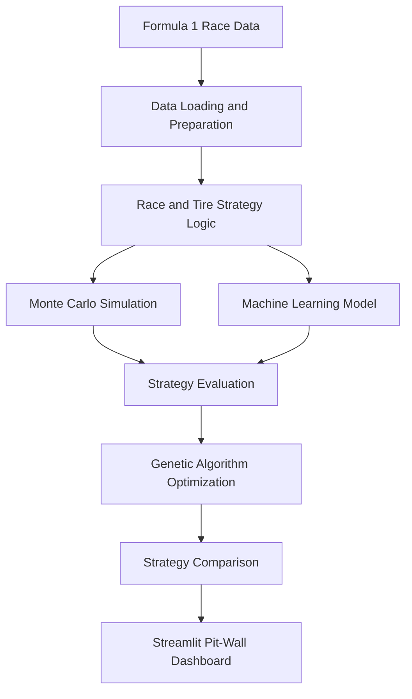

# 🏎️ F1 Strategy Suite
### AI-Powered Formula 1 Race Strategy Simulation & Optimization

<p align="center">
  <strong>Simulate race scenarios. Optimize pit-stop strategies. Make data-driven decisions.</strong>
</p>

<p align="center">
  
  
  
  
</p>

<p align="center">
  <a href="https://github.com/Dhruv908615/F1_strategy_suite">Repository</a> •
  <a href="https://github.com/Dhruv908615/F1_strategy_suite/issues">Report a Bug</a> •
  <a href="https://github.com/Dhruv908615/F1_strategy_suite/issues">Request a Feature</a>
</p>

---

## 🏁 Overview

**F1 Strategy Suite** is a Formula 1 race strategy analysis and optimization project that combines motorsport data, simulation, machine learning, and optimization algorithms to explore smarter race-day decisions.

Inspired by the strategic decisions made on the Formula 1 pit wall, the project provides a data-driven environment for analyzing tire degradation, evaluating pit-stop strategies, comparing race scenarios, and exploring alternative strategies under simulated race conditions.

Instead of relying on a single predicted outcome, the suite uses Monte Carlo simulation to evaluate multiple possible race scenarios and a Genetic Algorithm to explore promising strategy configurations.

The goal is to make complex race strategy concepts more accessible through an interactive dashboard built with Python and Streamlit.

## ✨ Key Features

### 🎲 Monte Carlo Race Simulation
- Simulate approximately 1,000 race scenarios to explore possible outcomes.
- Evaluate how uncertainty can affect race strategy decisions.
- Compare candidate strategies across repeated simulations.
- Analyze simulated outcomes rather than relying on a single deterministic prediction.

### 🛞 Tire Degradation Analysis
- Explore the relationship between tire age and performance.
- Visualize tire-related performance trends using heatmaps.
- Compare strategy scenarios involving different tire compounds and stint lengths.
- Understand how tire performance can influence pit-stop timing.

### 🧠 Machine Learning
- Train a machine learning model using simulated race data.
- Explore predictive modeling for race strategy analysis.
- Use data-driven predictions to complement simulation-based decisions.
- Build a foundation for experimenting with additional predictive features.

### 🧬 Genetic Algorithm Optimization
- Search for promising race strategy configurations using evolutionary optimization.
- Generate and evaluate candidate strategies.
- Apply selection, crossover, and mutation to explore the strategy search space.
- Compare optimized strategies against alternative configurations.

### 📊 Interactive Pit-Wall Dashboard
- Explore race strategy information through a Streamlit interface.
- Visualize simulation results and tire-related heatmaps.
- Compare candidate strategies and their simulated outcomes.
- Bring simulation, prediction, and optimization into one analysis workflow.

## 🧰 Tech Stack

| Technology | Purpose |
|---|---|
| Python | Core application and strategy logic |
| Streamlit | Interactive dashboard |
| FastF1 | Formula 1 timing and race data access |
| Machine Learning | Predictive analysis using simulated race data |
| Monte Carlo Simulation | Evaluating uncertainty across race scenarios |
| Genetic Algorithm | Exploring and optimizing strategy configurations |
| Data Visualization | Presenting race and tire-performance insights |

*The exact libraries used for machine learning, optimization, and plotting depend on the project's implementation and dependencies.*

## 🏗️ System Architecture

The project follows a strategy-analysis workflow that combines race data, simulation, prediction, optimization, and visualization.



### How It Works

1. **Data preparation:** Load available Formula 1 data and prepare the relevant race and tire information.
2. **Scenario generation:** Construct race strategy scenarios using the project's simulation logic.
3. **Simulation:** Run repeated Monte Carlo trials to evaluate possible outcomes.
4. **Prediction:** Use the trained machine learning model to support data-driven analysis.
5. **Optimization:** Explore candidate strategies using the Genetic Algorithm.
6. **Visualization:** Present the resulting analysis through the interactive dashboard.

## 🖥️ Getting Started

Follow these instructions to run F1 Strategy Suite on your local machine.

### Prerequisites

- Python 3.10 or a compatible version supported by the project dependencies
- Git
- A stable internet connection for retrieving Formula 1 data when required

### 1. Clone the Repository

```bash
git clone https://github.com/Dhruv908615/F1_strategy_suite.git
```

### 2. Navigate to the Project

```bash
cd F1_strategy_suite
```

### 3. Create a Virtual Environment

**Windows — PowerShell**

```powershell
python -m venv .venv
.\.venv\Scripts\Activate.ps1
```

If PowerShell blocks script execution, use Command Prompt instead:

```bat
.venv\Scripts\activate.bat
```

**macOS / Linux**

```bash
python3 -m venv .venv
source .venv/bin/activate
```

### 4. Install Dependencies

If the repository contains a `requirements.txt` file, run:

```bash
python -m pip install --upgrade pip
pip install -r requirements.txt
```

If dependencies are not listed there, install the packages specified by the project before running the application.

### 5. Launch the Dashboard

If `app.py` is the main Streamlit entry point, run:

```bash
streamlit run app.py
```

Streamlit will display a local URL, typically:

```text
http://localhost:8501
```

Open that URL in your browser to access the dashboard.

> **Note:** The commands above assume the repository uses `app.py` as its entry point and includes the indicated dependency file. Adjust the commands if your current project structure differs.

## 📈 Core Concepts

### Monte Carlo Simulation

Monte Carlo simulation evaluates a strategy over many trials while accounting for uncertainty represented in the simulation model.

For a race strategy, possible sources of uncertainty include:

- Variation in lap times
- Tire degradation
- Pit-stop time loss
- Safety-car scenarios, if modeled
- Differences in race conditions, if modeled

For a simulated outcome \(X\), the estimated expected outcome across \(N\) trials is:

\[
\hat{E}[X] = \frac{1}{N}\sum_{i=1}^{N} X_i
\]

Running repeated trials helps compare strategies across a range of possible scenarios. The usefulness of the results depends on how realistically the simulation models race conditions.

### Tire Strategy

Tire strategy involves balancing pace, degradation, stint length, and the time lost during pit stops.

A simplified strategy comparison considers:

\[
T_{\text{race}} =
\sum_{i=1}^{L} t_i +
\sum_{j=1}^{P} t_{\text{pit},j}
\]

Where:

- \(L\) is the number of race laps.
- \(t_i\) is the simulated time for lap \(i\).
- \(P\) is the number of pit stops.
- \(t_{\text{pit},j}\) is the time loss associated with pit stop \(j\).

This is a simplified representation; a realistic model must account for the assumptions and race conditions implemented in the project.

### Genetic Algorithm

A Genetic Algorithm searches for good solutions by evolving a population of candidate strategies.

Its typical workflow is:

1. Initialize candidate strategies.
2. Evaluate each strategy using the objective function.
3. Select promising candidates.
4. Apply crossover and mutation.
5. Evaluate the new population.
6. Repeat until the stopping condition is reached.

The quality of the final strategy depends on the fitness function, search constraints, and simulation assumptions.

## 🎯 Project Objectives

- Apply machine learning to a real-world-inspired motorsport problem.
- Explore probabilistic simulation for uncertain race outcomes.
- Investigate evolutionary algorithms for strategy optimization.
- Analyze tire degradation and pit-stop decisions using data.
- Build an interactive dashboard for exploring strategy scenarios.
- Develop practical experience with Python, data analysis, and applied AI/ML.

## 🔬 Future Improvements

The project can be extended with additional capabilities, including:

- **Real race telemetry:** Incorporate richer historical lap, sector, and telemetry data.
- **Weather-aware strategies:** Model how changing weather conditions influence tire selection and pit timing.
- **Safety-car scenarios:** Evaluate virtual safety car and safety car strategy changes.
- **Undercut and overcut analysis:** Compare pit timing and track-position trade-offs.
- **Driver and circuit comparisons:** Explore how driver pace and circuit characteristics affect strategy.
- **Model evaluation:** Measure predictive performance using appropriate validation data and metrics.
- **Strategy explainability:** Explain why a strategy is preferred and identify the assumptions behind the result.
- **Improved dashboard:** Add richer comparisons, interactive charts, and more detailed race reports.

These are potential extensions, not claims about features already implemented.

## ⚠️ Limitations

- Simulation results depend on the assumptions and parameters used by the model.
- Synthetic training data may not fully represent real-world racing conditions.
- Race data availability and retrieval behavior may depend on the underlying data source.
- An optimized simulated strategy is not guaranteed to be the optimal strategy in an actual race.
- Results should be interpreted as analytical estimates, not official team strategy recommendations.

## 🤝 Contributing

Contributions, suggestions, and improvements are welcome!

1. Fork the repository.
2. Create a feature branch.

   ```bash
   git checkout -b feature/your-feature
   ```

3. Make your changes and test them.
4. Commit your changes.

   ```bash
   git commit -m "Add: your feature"
   ```

5. Push the branch and open a Pull Request.

For larger changes, consider opening an issue first to discuss the proposed improvement.

## 📚 Data Source and Attribution

This project uses [FastF1](https://docs.fastf1.dev/) to access Formula 1 timing and telemetry-related data where supported by the implementation.

Formula 1 data availability, licensing, and usage restrictions should be checked against the relevant source documentation. This is an independent educational project and is not affiliated with or endorsed by Formula 1, the FIA, or any Formula 1 team.

## 👨‍💻 Author

**Dhruv Katiyar**

Computer Science Engineering — Artificial Intelligence & Machine Learning

- GitHub: [@Dhruv908615](https://github.com/Dhruv908615)
- Project Repository: [F1 Strategy Suite](https://github.com/Dhruv908615/F1_strategy_suite)
- Portfolio: [dhruv-portfolio-teal.vercel.app](https://dhruv-portfolio-teal.vercel.app/)

## 📄 License

No license is specified here. Check the repository for an existing `LICENSE` file before distributing or reusing the project. If you intend to publish it as open source, consider adding an appropriate license.

---

<p align="center">
  <strong>Built with Python, simulation, and a passion for Formula 1. 🏁</strong>
</p>
